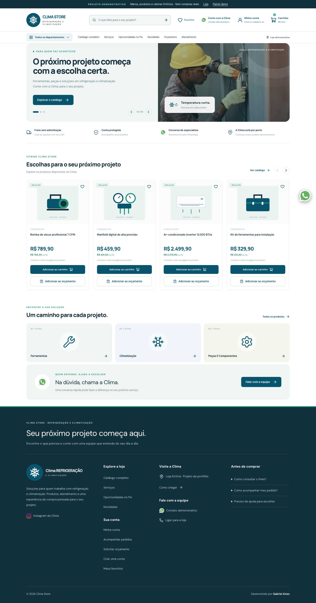
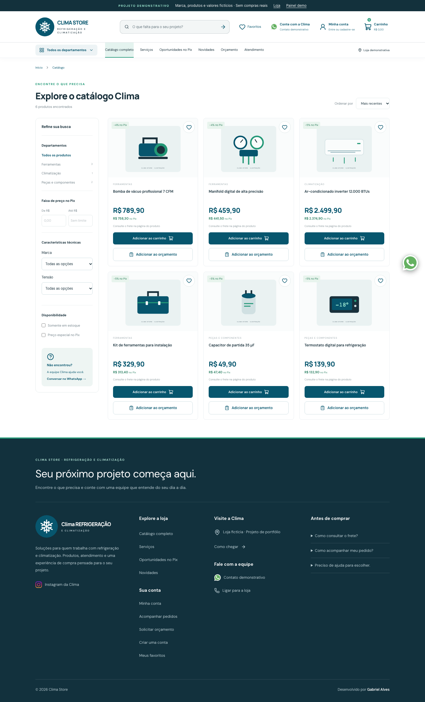
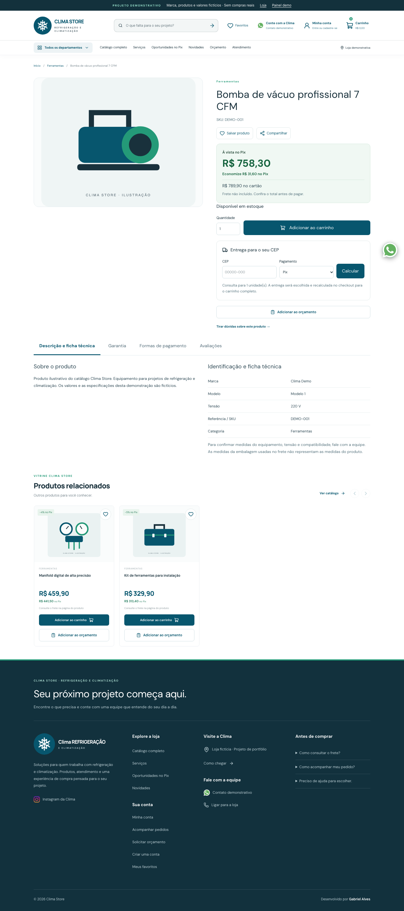
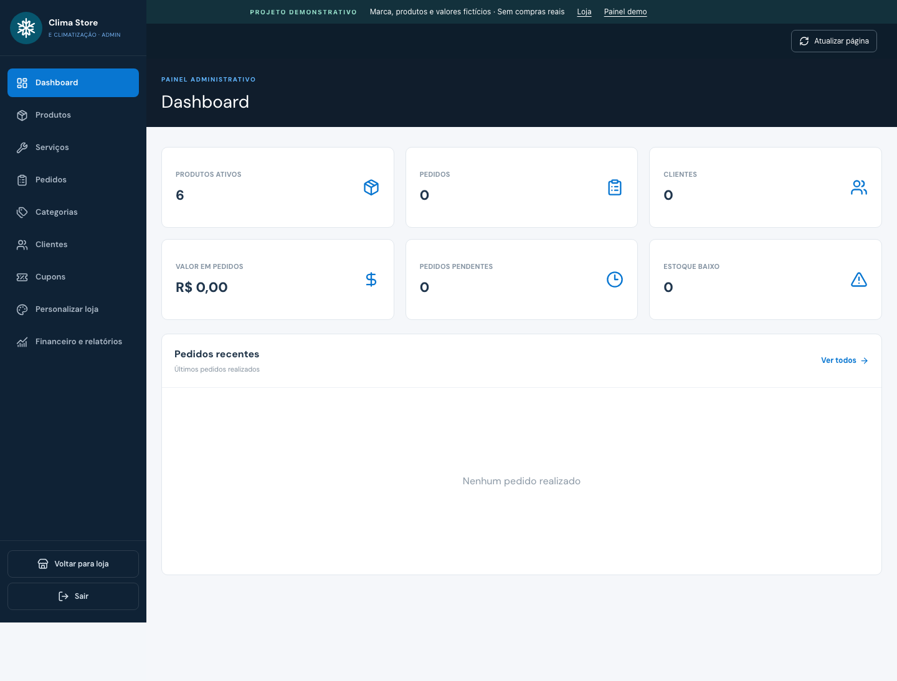
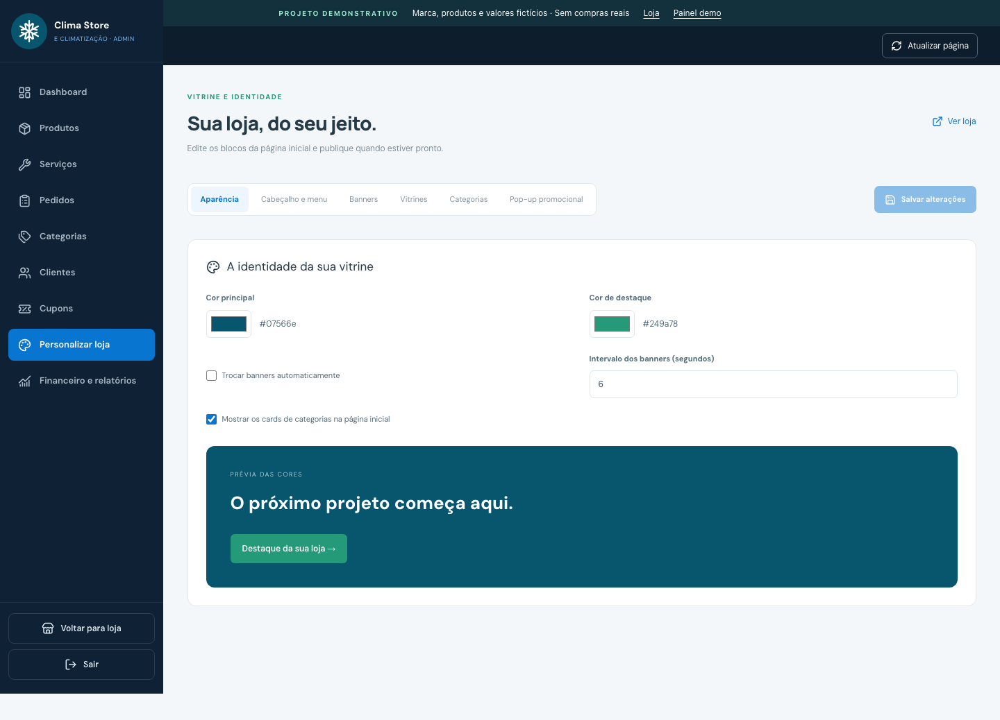
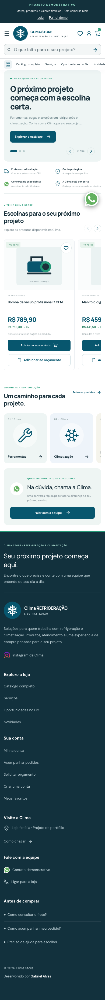

# Clima Store — e-commerce full stack

E-commerce de refrigeração e climatização desenvolvido como projeto demonstrativo de portfólio. A marca é fictícia; esta versão não representa uma entrega comercial nem uma loja em operação.

React 19 · TypeScript · Vite · Node.js · Express · PostgreSQL · Prisma 7

[Código-fonte](https://github.com/SheldonCupper/clima-store-portfolio) · [Capturas de tela](#telas) · [Como executar](#executar-a-demonstração)

## Telas

Capturas do modo de demonstração, com produtos, preços e ilustrações fictícios. O painel usa dados de exemplo e não contém clientes ou vendas reais.

### Página inicial


### Catálogo com filtros


### Página do produto


### Painel administrativo


### Personalização da loja


### Versão mobile


## O que foi desenvolvido

- Catálogo com busca, categorias, filtros técnicos, preços e disponibilidade.
- Página de produto com galeria, ficha técnica, favoritos e lista de orçamento.
- Carrinho, checkout e acompanhamento de pedidos.
- Contas de clientes, recuperação de senha e integração de login Google.
- Painel para produtos, categorias, serviços, cupons, pedidos e relatórios.
- Editor de banners, vitrines, cores, menu e campanhas promocionais.
- Integrações no backend com Mercado Pago, Melhor Envio e SMTP.
- Validação de preços e frete no servidor, controle de estoque e proteção de acesso a pedidos.

## Executar a demonstração

Requer Node.js 22.12+ e npm.

```sh
git clone https://github.com/SheldonCupper/clima-store-portfolio.git
cd clima-store-portfolio
npm ci
npm run dev:demo
```

Abra a URL exibida no terminal. A loja e `/admin` ficam disponíveis para exploração. Não é necessário criar `.env`, instalar PostgreSQL ou iniciar o backend.

**Limites do modo demo:** os dados são locais, o painel é uma prévia pública e operações de gravação, login, cadastro, frete, pagamentos e envio de mensagens não são executadas. Os indicadores de vendas permanecem zerados. As ilustrações de produtos são vetores originais feitos para esta demonstração.

Para gerar a versão estática:

```sh
npm run build:demo
npm run preview
```

## Aplicação completa

O código do backend e as migrations estão incluídos para demonstrar a implementação. Para executar com persistência, configure seu próprio banco e suas próprias contas de integração.

```sh
npm ci
npm --prefix server ci
cp .env.example .env
# Configure DATABASE_URL e JWT_SECRET no .env antes de continuar.
npx prisma generate --config prisma7.config.ts
npx prisma migrate deploy --config prisma7.config.ts
npm --prefix server run dev
# Em outro terminal:
npm run dev
```

O comando de migration deve ser executado somente no banco que você configurou para este projeto. As integrações opcionais estão documentadas em `.env.accounts.example`, `.env.shipping.example` e `.env.payments.example`; use sandbox ao testar pagamentos e frete.

## Verificação

```sh
npm run build:demo
npm run build
npm --prefix server run typecheck
npm --prefix server test
```

A suíte inclui testes de integração que são ignorados quando não há banco de testes explicitamente habilitado. Veja os arquivos de teste para as variáveis necessárias; não aponte esses testes para um banco de produção.

## Arquitetura

| Pasta | Responsabilidade |
| --- | --- |
| `src/` | Interface, rotas, estado do carrinho e painel |
| `src/demo/` | Catálogo fictício e respostas locais do modo demo |
| `shared/` | Contratos e validações compartilhados |
| `server/src/` | API, autenticação e integrações |
| `prisma/` | Modelo relacional e migrations |
| `docs/` | Guias técnicos e capturas de tela |

Foto de destaque: [Unsplash](https://images.unsplash.com/photo-1621905251189-08b45d6a269e), usada como imagem ilustrativa. Demais ilustrações do catálogo demo e símbolo da marca estão em `public/`.

## Publicação como portfólio

Gere a cópia sanitizada e o ZIP com `python3 scripts/export-portfolio.py` (requer Python 3). Os arquivos são criados em `artifacts/`. Use um repositório novo a partir dessa cópia, sem importar o histórico de desenvolvimento anterior. A exportação deve conter somente código, documentação e assets públicos; `.env`, uploads, dumps, arquivos de chave e dados de operação ficam de fora.

Para uma apresentação estática, publique `dist/` após `npm run build:demo`. Veja [publicação da demo](docs/publicacao-netlify.md). O frontend completo com backend próprio usa [configuração de servidor](docs/publicacao-aws.md).
